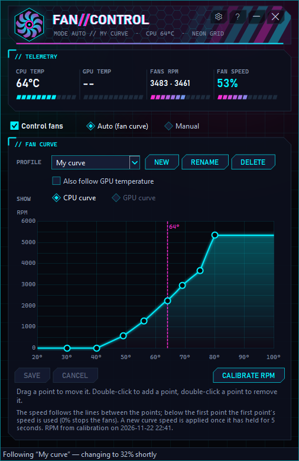
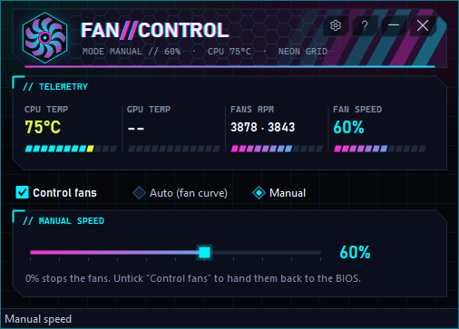

# Asus Fan Control

### Download
Go to [releases](../../releases). Two downloads are offered:

- **`AsusFanControl-Setup-vX.Y.Z.exe`** (recommended): installs into `C:\Program Files\Asus Fan Control`, adds a Start menu shortcut (optionally a desktop one), can turn on Start with Windows, and appears in **Settings → Apps** for uninstalling. Running a newer Setup upgrades in place; it closes the running app first. Uninstalling closes the app (the fans go back to the BIOS), removes Start with Windows, and asks whether to delete your settings. Windows SmartScreen may warn because the installer is not code-signed: choose **More info → Run anyway**.
- **`AsusFanControl-x64-Release-vX.Y.Z.zip`** (portable): unzip somewhere permanent and double-click `run.bat`.

Settings, profiles and the log are in `C:\ProgramData\AsusFanControl` either way, so they survive updates and switching between the two.

### Run

    
Command line: `AsusFanControl.exe`

    
    AsusFanControl.exe <args>
        --get-fan-speeds
        --set-fan-speeds=0-100 (percent value, 0 for turning off test mode)
        --get-fan-count
        --get-fan-speed=fanId (comma separated)
        --set-fan-speed=fanId:0-100 (comma separated, percent value, 0 for turning off test mode)
        --get-cpu-temp

GUI: `AsusFanControlGUI.exe`  

After building (e.g. Release | x64), the output folder `bin\x64\Release\` contains the exes and `run.bat`. Double‑click `run.bat` to launch the GUI with admin rights (it uses PsExec if present). To have PsExec copied automatically, place `PsExec.exe` in the `AsusFanControlGUI` project folder once; then every build will copy it to the output folder.

GUI command-line options (used by the shortcuts and the installer): `--as-system` restarts the app as SYSTEM through `PsExec.exe` with no console window, `--minimized` starts it in the notification area, `--exit` closes a running copy and hands the fans to the BIOS, and `--startup on|off` turns Start with Windows on or off. Starting the app while it is already running brings its window forward.

**Building the installer:** install [Inno Setup 6](https://jrsoftware.org/isinfo.php) and Visual Studio (MSBuild), then run

    powershell -ExecutionPolicy Bypass -File installer\build-installer.ps1

It builds Release | x64 into an empty folder and writes `AsusFanControl-Setup-vX.Y.Z.exe` and the portable zip to `installer\Output\`. The version comes from `AsusFanControlGUI\Properties\AssemblyInfo.cs`. `PsExec.exe` is not in the repository; the script takes it from `AsusFanControlGUI\PsExec.exe` or `bin\x64\Release\PsExec.exe`, or pass `-PsExec <path>`.

| Auto (fan curve) | Manual |
|---|---|
|  |  |

### Why need it?
My laptop does not support the [Fan Profile](https://github.com/Karmel0x/AsusFanControl/assets/25367564/924d990a-bf20-4b8d-bf9d-56c460174d99) option, but it often overheats. Looked for apps to control fans, but none is working.

### Compatibility
This program should work on any laptop with x64 windows where [Fan Diagnosis](https://github.com/Karmel0x/AsusFanControl/assets/25367564/7129833b-97af-4da8-9148-b71e49552ea4) in [MyASUS](https://apps.microsoft.com/store/detail/myasus/9N7R5S6B0ZZH) application is working as it is using same library.

[ASUS System Control Interface](https://www.asus.com/support/faq/1047338/) is necessary for this software to work - `ASUS System Analysis` service [must be running](../../issues/16). It's automatically installed with `MyASUS` app.

**If fan control has no effect:** Run the app **as Administrator** (right‑click → Run as administrator). The GUI is built to request admin elevation. Also ensure the ASUS System Analysis service is running (Services → "ASUS System Analysis" or "AsusSystemAnalysis") and that your model supports [Fan Diagnosis](https://github.com/Karmel0x/AsusFanControl/assets/25367564/7129833b-97af-4da8-9148-b71e49552ea4) in MyASUS. You can test from command line (as admin): `AsusFanControl.exe --get-fan-count` then `AsusFanControl.exe --set-fan-speeds=80`.

Included `AsusWinIO64.dll` is licenced to `(c) ASUSTek COMPUTER INC.` which can be found in `C:\Windows\System32\DriverStore\FileRepository\asussci2.inf_amd64_-\ASUSSystemAnalysis\` if you have MyASUS installed.

[Works on](../../issues/13): 
- ASUS: VivoBook, ZenBook, TUF Gaming, ROG Strix, ROG Zephyrus, ROG Flow

---

### GUI features

- **Manual and Auto mode.** Manual holds one fan speed. Auto follows a temperature curve. The top of the window always shows CPU and GPU temperature, fan RPM and the speed being applied, as segmented bars that change colour as temperatures rise.

- **Fan curve profiles.** A curve has 2 to 8 points joined by straight lines; below the first point the first point's speed is used and above the last point the last point's (start with a 0% point to have the fans stop when cool). *Balanced*, *Quiet* and *Performance* are included; **New** copies the current profile, and profiles can be renamed or deleted. The tray menu switches profiles too. Step curves from versions before 1.5 are converted on first start, with a 0% point added 5 °C below the first step.

- **Edit the curve on the graph.** The graph is the editor: drag a point to move it (left/right sets its temperature, up/down its fan speed), double-click empty space to add a point, double-click a point to remove it. Hovering a point shows its values. **Save** (Enter) applies the curve; **Cancel** (Esc) puts the saved one back. Switching profile, curve or mode with unsaved changes asks whether to save.

- **RPM on the graph.** **Calibrate RPM** runs the fans at 10%, 20% … 100% (one to two minutes, loud near the end) and stores the measured RPM. The graph then shows RPM instead of %; the fans are still driven by percent.

- **GPU curve.** Tick **Also follow GPU temperature** to give the profile a second curve; the fans run at whichever curve asks for more. GPU temperature comes from `AsusWinIO64.dll` (`Thermal_Read_GpuTS1L_Temperature`, or `TS1R` when the left sensor has no reading). All fans get the same speed.

- **What 0% means.** In the GUI, 0% stops the fans (test mode on, duty 0). Unticking **Control fans** hands the fans back to the BIOS (test mode off). If no temperature can be read, Auto mode hands the fans to the BIOS as well. The command line keeps its old meaning: `--set-fan-speeds=0` turns test mode off.

- **Steadier control.** A new curve speed is applied once it has held for 5 seconds, and changes smaller than 3% are ignored, so the EC is not written on every degree; your own changes apply at once. The EC can drop out of test mode on its own (for example around Modern Standby), so the app re-sends the current speed every 15 seconds.

- **Sleep.** Sleep is detected for classic sleep and for Modern Standby, which often does not send the usual suspend notification. **Settings → Hand fans to the BIOS during sleep** (on by default) releases the fans while asleep; with it off, the current speed is kept. On wake the speed is applied again.

- **Start with Windows.** Creates a logon task named `AsusFanControlGUI` for the signed-in user, also when the app runs as SYSTEM. It starts on battery, has no time limit, starts the app in the notification area, and, when `PsExec.exe` is in the app folder, restarts itself as SYSTEM through it with no console window (some laptops only allow fan control from SYSTEM, as with `run.bat`). Only one copy runs at a time.

- **Settings.** Settings and profiles are saved in `%ProgramData%\AsusFanControl\settings.json`, shared by every account, so they survive restarts, running as SYSTEM and unzipping a new release elsewhere. Settings from earlier versions are imported on first run. `log.txt` in the same folder records starts, sleep/wake and fan changes; **Settings → Open settings and log folder** opens it.

- **Other settings.** Keep running in the notification area when closed, hand fans to the BIOS on exit, and limit non-zero speeds to 40–99%.

- **Themes.** **Settings → Theme** switches between *Neon Grid* (default), *Crimson Strike*, *Matrix*, *Ember* and the light *Daylight*; the choice is saved. Everything is drawn in code: cut-corner panels, a turbine in the header that spins with the fan RPM, and HUD-style readouts. Chakra Petch / JetBrains Mono are used when installed, otherwise Bahnschrift / Cascadia Mono.

- **Borderless window.** The header is the title bar: drag it (or any empty space) to move the window, with Windows Snap; the buttons at its top right open Settings and Help, minimize and close. The taskbar button and Alt+Space work as usual.
