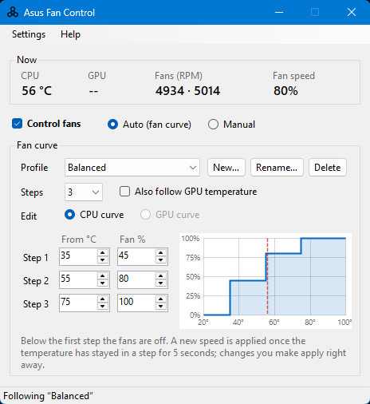
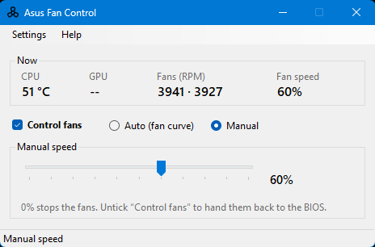

# Asus Fan Control

### Download
Go to [releases](../../releases)

### Run

    
Command line: `AsusFanControl.exe`

    
    AsusFanControl.exe <args>
        --get-fan-speeds
        --set-fan-speeds=0-100 (percent value, 0 for turning off test mode)
        --get-fan-count
        --get-fan-speed=fanId (comma separated)
        --set-fan-speed=fanId:0-100 (comma separated, percent value, 0 for turning off test mode)
        --get-cpu-temp

GUI: `AsusFanControlGUI.exe`  

After building (e.g. Release | x64), the output folder `bin\x64\Release\` contains the exes and `run.bat`. Double‑click `run.bat` to launch the GUI with admin rights (it uses PsExec if present). To have PsExec copied automatically, place `PsExec.exe` in the `AsusFanControlGUI` project folder once; then every build will copy it to the output folder.

| Auto (fan curve) | Manual |
|---|---|
|  |  |

### Why need it?
My laptop does not support the [Fan Profile](https://github.com/Karmel0x/AsusFanControl/assets/25367564/924d990a-bf20-4b8d-bf9d-56c460174d99) option, but it often overheats. Looked for apps to control fans, but none is working.

### Compatibility
This program should work on any laptop with x64 windows where [Fan Diagnosis](https://github.com/Karmel0x/AsusFanControl/assets/25367564/7129833b-97af-4da8-9148-b71e49552ea4) in [MyASUS](https://apps.microsoft.com/store/detail/myasus/9N7R5S6B0ZZH) application is working as it is using same library.

[ASUS System Control Interface](https://www.asus.com/support/faq/1047338/) is necessary for this software to work - `ASUS System Analysis` service [must be running](../../issues/16). It's automatically installed with `MyASUS` app.

**If fan control has no effect:** Run the app **as Administrator** (right‑click → Run as administrator). The GUI is built to request admin elevation. Also ensure the ASUS System Analysis service is running (Services → "ASUS System Analysis" or "AsusSystemAnalysis") and that your model supports [Fan Diagnosis](https://github.com/Karmel0x/AsusFanControl/assets/25367564/7129833b-97af-4da8-9148-b71e49552ea4) in MyASUS. You can test from command line (as admin): `AsusFanControl.exe --get-fan-count` then `AsusFanControl.exe --set-fan-speeds=80`.

Included `AsusWinIO64.dll` is licenced to `(c) ASUSTek COMPUTER INC.` which can be found in `C:\Windows\System32\DriverStore\FileRepository\asussci2.inf_amd64_-\ASUSSystemAnalysis\` if you have MyASUS installed.

[Works on](../../issues/13): 
- ASUS: VivoBook, ZenBook, TUF Gaming, ROG Strix, ROG Zephyrus, ROG Flow

---

### GUI features

- **Manual and Auto mode.** Manual holds one fan speed. Auto follows a temperature curve. The top of the window always shows CPU and GPU temperature, fan RPM and the speed being applied.

- **Fan curve profiles.** A profile has 2 or 3 steps; each step is a temperature and a fan speed that applies from that temperature up to the next step. Below the first step the fans are off. *Balanced*, *Quiet* and *Performance* are included; **New…** copies the current profile, and profiles can be renamed or deleted. The tray menu switches profiles too. A graph shows the curve with the current temperature.

- **Edit the curve on the graph.** Click **Edit graph** under the graph, then drag a step's point: left/right sets its temperature, up/down its fan speed. A label shows the values while you drag, and steps cannot be dragged past each other. **Save** applies the new curve; **Cancel** (or Esc) discards it. Typing values in the boxes still works and applies right away.

- **GPU curve.** Tick **Also follow GPU temperature** to give the profile a second curve; the fans run at whichever curve asks for more. GPU temperature comes from `AsusWinIO64.dll` (`Thermal_Read_GpuTS1L_Temperature`, or `TS1R` when the left sensor has no reading). All fans get the same speed.

- **What 0% means.** In the GUI, 0% stops the fans (test mode on, duty 0). Unticking **Control fans** hands the fans back to the BIOS (test mode off). If no temperature can be read, Auto mode hands the fans to the BIOS as well. The command line keeps its old meaning: `--set-fan-speeds=0` turns test mode off.

- **Steadier control.** A new curve speed is applied once the temperature has stayed in a step for 5 seconds; your own changes apply at once. The EC can drop out of test mode on its own (for example around Modern Standby), so the app re-sends the current speed every 15 seconds.

- **Sleep.** Sleep is detected for classic sleep and for Modern Standby, which often does not send the usual suspend notification. **Settings → Hand fans to the BIOS during sleep** (on by default) releases the fans while asleep; with it off, the current speed is kept. On wake the speed is applied again.

- **Start with Windows.** Creates a logon task named `AsusFanControlGUI` for the signed-in user, also when the app runs as SYSTEM. It starts on battery, has no time limit, starts the app in the notification area, and, when `PsExec.exe` is in the app folder, restarts itself as SYSTEM through it with no console window (some laptops only allow fan control from SYSTEM, as with `run.bat`). Only one copy runs at a time.

- **Settings.** Settings and profiles are saved in `%ProgramData%\AsusFanControl\settings.json`, shared by every account, so they survive restarts, running as SYSTEM and unzipping a new release elsewhere. Settings from earlier versions are imported on first run. `log.txt` in the same folder records starts, sleep/wake and fan changes; **Settings → Open settings and log folder** opens it.

- **Other settings.** Keep running in the notification area when closed, hand fans to the BIOS on exit, and limit non-zero speeds to 40–99%.
